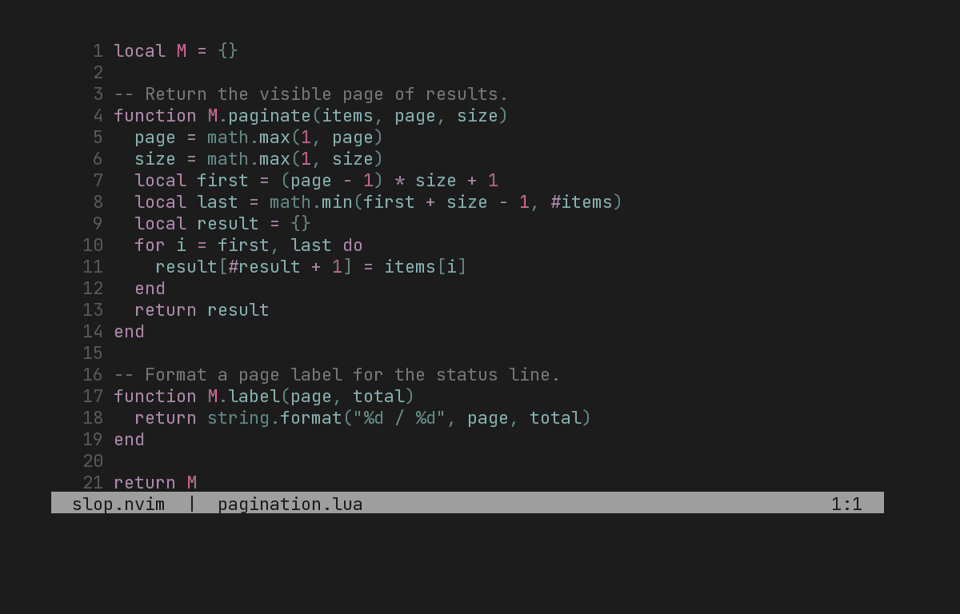

# slop.nvim demo

Videos and recording tools for [slop.nvim](https://github.com/antti-bot/slop.nvim).

[](demo/slop-demo.mp4)

The demo walks through a review in Neovim: finding changes, writing a comment,
adding a suggestion, checking drafts, and submitting a summary. The MP4 and GIF
show just the editor, with no captions or overlays.

Clone this repo alongside `slop.nvim` and `gitsigns.nvim`.
Set `SLOP_PLUGIN_ROOT` if your plugin checkout lives elsewhere.

To make a fresh recording, you need Rex, Git, Neovim 0.11+, a Gitsigns checkout,
Python, and a monospace TTF font. Install the rendering dependencies once:

```sh
python3 -m pip install -r demo/requirements.txt
```

Then run this from the repository root:

```sh
DEMO_FONT=/path/to/JetBrainsMono.ttf make demo
```

If Neovim or Gitsigns lives elsewhere:

```sh
DEMO_FONT=/path/to/JetBrainsMono.ttf make demo \
  NVIM=/path/to/nvim GITSIGNS_RTP=/path/to/gitsigns.nvim
```

Without Make, set the same environment variables and run `python3 demo/create.py`.
Use `PYTHON=/path/to/python` with Make to select a virtual environment.

The script creates a temporary Git repository and its own Rex session, records
the workflow, checks that both comments and the summary were submitted, and
removes the session and temporary files. It uses `tests/gh` for GitHub responses,
so recording needs no credentials and doesn't create public PRs or reviews.
It leaves your existing Rex sessions alone, including on a failed recording.

The outputs are `slop-demo.mp4`, `slop-demo.gif`, and `poster.png`. Styled terminal
captures and scene timings are saved too. To render those again without opening
Neovim, run `DEMO_FONT=/path/to/JetBrainsMono.ttf make render`.

The font is supplied separately and isn't bundled with the demo.
